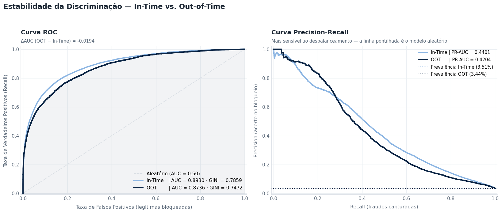
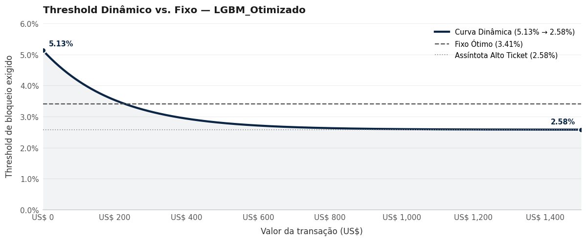
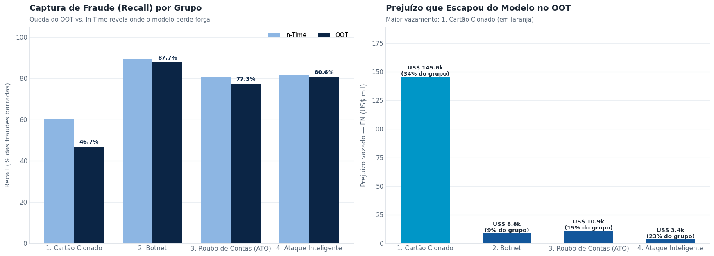

# 💳 Detecção de Fraude em Pagamentos Online — IEEE-CIS


> 📄 **[Relatório completo de análise de negócio (PDF)](Relatorio_Analise_Fraude.pdf)**: storytelling, perfis de fraude, decisões e recomendações.

---

## 📌 Sobre o Projeto

Fraude é só **3,5%** das transações, mas cada fraude aprovada custa **100%** do valor, enquanto uma venda legítima rende **2%**. Este projeto constrói um sistema de decisão antifraude de ponta a ponta sobre as **590.540 transações** da competição [IEEE-CIS Fraud Detection](https://www.kaggle.com/c/ieee-fraud-detection) (Vesta Corporation):

- **Modelo:** LightGBM com **30 features** selecionadas por SHAP e **calibração isotônica** (score → probabilidade real);
- **Decisão:** **threshold dinâmico por valor da transação**, otimizado em dólares (mais tolerante em micro-compras, mais rigoroso em tickets altos);
- **Segmentação:** 4 **arquétipos de fraude** (UMAP + K-Means) para entender quem ataca e onde o modelo falha;
- **Validação honesta:** split temporal **60/20/20**, com os 20% mais recentes (**Out-of-Time**) isolados até a avaliação final.

---

## 🏆 Principais Resultados (Out-of-Time: período futuro nunca visto)

| Indicador | Sem modelo | **Com o modelo** |
| :--- | :---: | :---: |
| Resultado financeiro | −US$ 297.264 | **+US$ 35.861** |
| Fraudes bloqueadas (Recall) | 0% | **68,0%** |
| Clientes legítimos aprovados | 100% | **87,6%** |
| GINI / KS | — | **0,747 / 0,577** |

- **+US$ 333 mil** de diferença em ~6 semanas e **US$ 441 mil** em fraudes evitadas (72% do valor fraudado);
- os **10% de maior score concentram 61% das fraudes** (lift de 6,1x), sem inversões na escada de risco;
- população estável no futuro: **PSI do score = 0,003**, 29 de 30 features estáveis e todas as semanas lucrativas.

<p align="center"></p>

**A regra de decisão:** o corte dinâmico lucrou mais que o corte fixo ótimo e que o clássico 0,50 na Validação, aprovando mais clientes legítimos.

<p align="center"></p>

**Onde o dinheiro escapa:** o modelo barra 88% da *Botnet*, mas só 47% do *Cartão Clonado*, que responde por 86% do chargeback vazado no OOT.

<p align="center"></p>

---

## ⚖️ Pontos Fortes e Fracos do Modelo

| ✅ Pontos fortes | ⚠️ Pontos fracos |
| :--- | :--- |
| Lucrativo em período futuro: reverte −US$ 297 mil em +US$ 35,9 mil | **Cartão Clonado:** Recall cai de 60,5% para **46,7%** no OOT e concentra 86% do vazamento |
| Decisão orientada a custo (+2% / −100%), não a métricas abstratas | Perda moderada de discriminação no futuro (GINI −4,9%, Recall −7 p.p.) |
| Forte contra automação: Botnet, Roubo de Contas e Ataque Inteligente com Recall de 77–88% | Subestima a fraude fora do treino (probabilidade calibrada −15% no OOT) |
| Enxuto e estável: 30 features, PSI baixo, mesmos motores de decisão In-Time vs. OOT (Spearman SHAP = 0,93) | Parte dos sinais fortes é anonimizada (ex.: `V70`), com pouca interpretação de negócio |
| Hipóteses alternativas testadas e descartadas com evidência (threshold por grupamento) | O `LGBM_Max` (125 features) lucrou ~US$ 6,3 mil a mais na Validação; a parcimônia foi priorizada |

---

## 🚀 Como Executar

```bash
git clone https://github.com/caua-barreto/Fraud_Detection_Model.git
cd Fraud_Detection_Model
python -m venv .venv && source .venv/bin/activate      # Windows: .venv\Scripts\activate
pip install -r requirements.txt                          # versões fixadas (ambiente dos notebooks)
```

Os dados brutos ficam em `data/raw/` (não versionados). Baixe-os da competição ou ative o download automático via KaggleHub (`--set paths.auto_download_kaggle=true`).

**Opção 1 — Notebooks (análise com storytelling):** execute `notebooks/01` a `05`, em ordem.

**Opção 2 — Pipeline reprodutível (somente Python):**

```bash
python main.py                                  # prepare -> train -> segment -> evaluate -> predict
python main.py --steps train evaluate           # apenas algumas etapas
python main.py --experiment xgb_fixo --set model.estimator=xgboost --set decision_policy.mode=fixed
python main.py --overwrite-default              # grava nos caminhos usados pelos notebooks
python -m pytest tests -q                       # testes de paridade e sanidade
```

- Todos os parâmetros (split, features, Optuna, calibração, regra financeira, segmentação) estão em **`configs.yaml`** e podem ser sobrescritos com `--set`;
- cada experimento é salvo isolado em `experiments/<nome>/`, com `configs_resolvido.yaml` e `run_manifest.json` (commit git, versões e status), sem alterar os arquivos dos notebooks;
- as figuras são exportadas automaticamente para `reports/figures/`, e o relatório PDF é regerado com `python scripts/gerar_relatorio_pdf.py`.

---

## 📁 Estrutura do Repositório

```
Fraud_Detection_Model/
├── Relatorio_Analise_Fraude.pdf   # relatório de negócio completo
├── main.py                        # orquestrador CLI do pipeline
├── configs.yaml                   # configuração única dos experimentos
├── requirements.txt               # dependências com versões exatas
├── notebooks/                     # 01_EDA · 02_Modelagem · 03_Segmentacao · 04_Avaliacao · 05_Submissao
├── src/                           # código modular (importado pelos notebooks e scripts)
│   ├── data/                      #   carga, split temporal, caudas longas
│   ├── features/                  #   engenharia (treino = inferência) e seleção (IV, correlação, SHAP)
│   ├── models/                    #   treino/Optuna, calibração, regra de decisão, artefatos
│   ├── evaluation/                #   métricas, drift (PSI/KS) e SHAP
│   ├── segmentation/              #   arquétipos de fraude e threshold por grupamento
│   └── visualization/             #   tema azul e gráficos (exportação automática)
├── scripts/                       # etapas do pipeline (01_prepare_data ... 05_segment_fraud) + relatório PDF
├── tests/                         # paridade de features treino x test, config, figuras
├── artifacts/                     # modelo .joblib, metadados, métricas e monitoramento OOT
├── reports/                       # figures/ (gráficos) e metrics/ (CSVs e JSONs)
└── data/                          # raw/ e processed/ (não versionados)
```

| Notebook | Pergunta que responde |
| :--- | :--- |
| `01_EDA` | Quando, onde e como a fraude acontece? Quais features construir e manter? |
| `02_Modelagem` | Qual modelo, quais features e qual regra de corte maximizam o lucro? |
| `03_Segmentacao` | Quem são os fraudadores? Um corte por grupo de clientes ajudaria? |
| `04_Avaliacao` | O modelo se sustenta no futuro? Onde ele falha? O que mudou nos dados? |
| `05_Submissao` | A escoragem da base cega do Kaggle é estável e consistente? |

---

*Desenvolvido por **Cauã de Freitas Barreto** — Junior Data Scientist · [GitHub](https://github.com/caua-barreto) · [LinkedIn](https://www.linkedin.com/in/caua-fbarreto-)*
